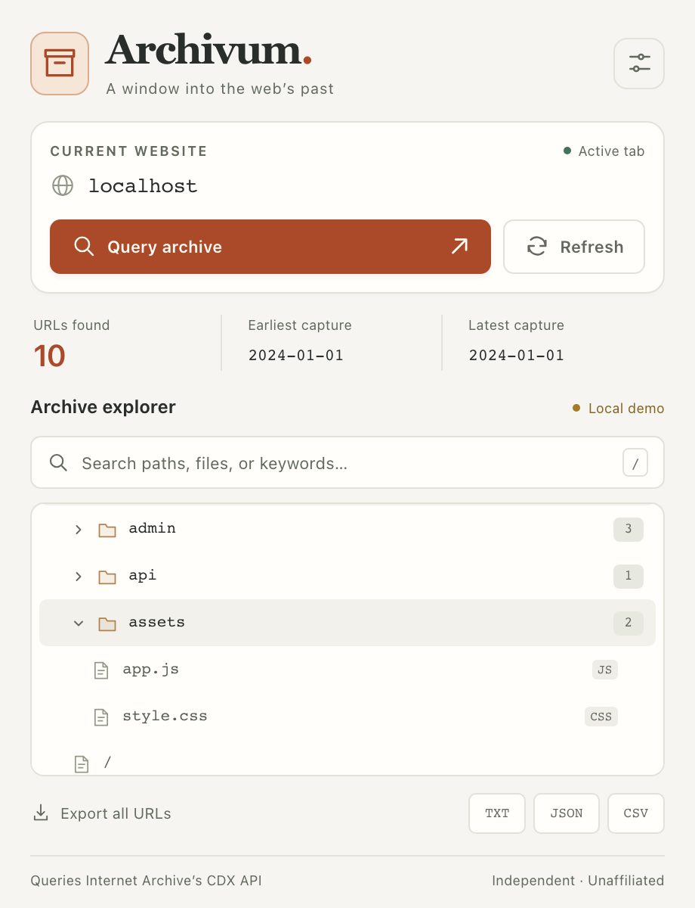
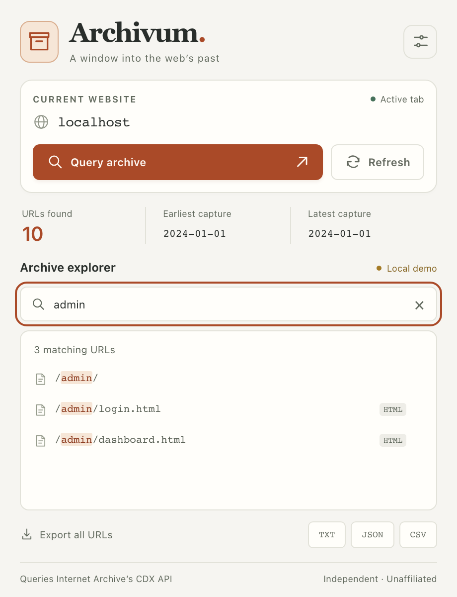

# Archivum

**Explore a website’s archived URLs from your browser.**

Archivum is a small browser extension for discovering pages, files, and paths recorded in the Wayback Machine. Query the current website, browse the results as folders, search URL text, and export your findings.

**Independent project:** Archivum is not affiliated with, partnered with, sponsored by, or endorsed by Internet Archive. It sends requests directly from your browser to Internet Archive’s public Wayback Machine CDX API. Internet Archive does not provide or officially support this extension.

[Install](#install) · [Usage guide](docs/USAGE.md) · [How requests work](#how-requests-work) · [Responsible use](#responsible-use) · [MIT license](LICENSE)

## In action

These are screenshots of the actual popup using its built-in **Local demo**. The URLs and capture dates are synthetic, not live Internet Archive findings.

<table>
  <tr>
    <th>Browse folders and files</th>
    <th>Search and export</th>
  </tr>
  <tr>
    <td></td>
    <td></td>
  </tr>
</table>

The [usage guide](docs/USAGE.md) also shows the starting screen and query options.

## Features

- Query the active website’s hostname with optional date and HTTP-status filters.
- Browse a collapsible folder tree that retains directory landing pages and URL variants.
- Search paths, filenames, extensions, hostnames, and query strings.
- View the number of returned URLs and the earliest/latest capture dates in that result set.
- Export the full query results as TXT, JSON, or CSV.
- Reuse local results for 30 minutes, or explicitly refresh from the API.
- Use keyboard shortcuts, visible focus indicators, and reduced-motion support.

Plain HTML, CSS, and JavaScript. Manifest V3. No build step, account, or project-hosted backend.

## Install

### Chrome

1. Download this repository with **Code → Download ZIP** and extract it, or clone it:

   ```sh
   git clone https://github.com/saazwho/ArchiveSiteScanner.git
   ```

2. Open `chrome://extensions` in Chrome.
3. Enable **Developer mode**.
4. Select **Load unpacked** and choose the extracted repository folder containing `manifest.json`.
5. Open an HTTP or HTTPS website, then open **Archivum** from the extensions menu. You can pin it to the toolbar for easier access.

This follows Chrome’s [unpacked-extension installation procedure](https://developer.chrome.com/docs/extensions/get-started/tutorial/hello-world#load-unpacked). Other Chromium-based browsers with unpacked-extension support use a similar process; the automated UI checks run in Chromium. Firefox and Safari compatibility has not been verified.

After updating the files, use **Reload** on Archivum’s extension card and reopen its popup.

## Quick start

1. Check the **Current website** shown in the popup.
2. Optionally open the sliders button to set a result limit, dates, or successful responses only.
3. Select **Query archive**. Expand folders to browse, or type in the search box.
4. Select **TXT**, **JSON**, or **CSV** to download all returned results. Search does not reduce the export.

**Result links open the original URL in a new tab, not a Wayback snapshot.** Opening a result can contact the current website. A URL’s presence in the archive does not mean it is still available today.

Press `/` to focus search. Press `Esc` to clear a focused search or dismiss query options. See the [full usage guide](docs/USAGE.md) for filters, caching, a local demo, and troubleshooting.

## How requests work

On **Query archive**, Archivum first looks for a valid local cache entry for that hostname and the selected options. A cache miss, or **Refresh**, sends one HTTPS `GET` request directly to:

```text
https://web.archive.org/cdx/search/cdx
```

For a tab on `https://example.com/some/page`, the default request is equivalent to:

```text
https://web.archive.org/cdx/search/cdx?url=example.com%2F*&output=json&fl=original%2Ctimestamp%2Cstatuscode%2Cmimetype&collapse=urlkey&limit=5000&filter=statuscode%3A200
```

| Parameter | What Archivum sends |
| --- | --- |
| `url` | The active tab’s hostname plus `/*`. The tab’s current path and query string are not used. |
| `output` | `json` |
| `fl` | `original,timestamp,statuscode,mimetype` |
| `collapse` | `urlkey`, requesting collapsed URL results rather than every capture |
| `limit` | `5000` by default; configurable from `100` to `50000` |
| `filter` | `statuscode:200` when **Successful pages only** is selected |
| `from`, `to` | Optional dates entered as `YYYYMMDD` |

The request code is in [`popup.js`](popup.js). Internet Archive maintains the [CDX API documentation](https://github.com/internetarchive/wayback/tree/master/wayback-cdx-server), including the endpoint’s matching, filtering, and collapsing behavior.

Archivum queries the archive’s index; it does not crawl the target website, submit pages for archiving, or retrieve page bodies during a query. It does not paginate beyond the chosen result limit or automatically retry failed requests. Each request times out after 45 seconds. Localhost and `127.0.0.1` use the built-in demo without an API call.

Results are a limited, collapsed set of indexed URLs. Capture-date statistics describe that set, not the website’s complete history or each URL’s most recent capture. Subdomains are not automatically enumerated. Availability and completeness depend on Internet Archive’s service and index.

## Privacy and permissions

| Permission | Why it is needed |
| --- | --- |
| `activeTab` | Read the active tab’s URL when you open the extension, then extract its hostname. |
| `storage` | Cache returned URLs and metadata locally in the browser. |
| `https://web.archive.org/*` | Allow direct CDX API requests to Internet Archive. |

Archivum has no analytics, telemetry, developer-operated server, or background browsing-history collection. A live query shares the hostname and filter values with Internet Archive; that service also receives the network information inherent in a direct request, including your IP address. Local text searches and export generation do not make API requests.

Cached records include URLs, timestamps, status codes, and MIME types. They remain valid for 30 minutes. Expired entries are removed during cleanup when the popup opens or a query starts, rather than by a background timer. Exports are ordinary local files and remain until you delete them. Treat cache contents and exports as potentially sensitive.

## Responsible use

Use Archivum for legitimate research, preservation, and authorized security work. Publicly indexed URLs may still contain sensitive information or point to systems you are not authorized to access.

- Respect privacy, applicable law, content rights, and [Internet Archive’s terms](https://archive.org/about/terms).
- Obtain appropriate authorization before testing or interacting with a discovered system. An archived URL is not permission to access it.
- Start with modest result limits, reuse cached responses, and avoid repeatedly forcing refreshes. If requests fail or are rate-limited, wait before retrying.
- Handle exports carefully. Do not publish credentials, tokens, personal data, or other sensitive material discovered in URLs.
- Report exposures through the affected organization’s responsible disclosure process.

These are responsible-use guidelines. The software’s license terms are in [LICENSE](LICENSE).

## Development and contributions

Run the checks with Node.js 24 or newer:

```sh
node --check popup.js
node --test tests/popup.test.cjs
```

The regression tests use mocked responses and do not query Internet Archive. GitHub Actions runs syntax and regression checks on pushes and pull requests. See [development notes](docs/DEVELOPMENT.md) for the file layout, manual checks, and regenerating the screenshots.

Issues and pull requests are welcome. Include reproduction steps and your browser version, and remove sensitive URLs or exported records before attaching examples.

## License

[MIT](LICENSE) © 2026 Jon (saazwho). The license covers this project’s code and documentation; it does not grant rights to third-party archived content or Internet Archive branding.
