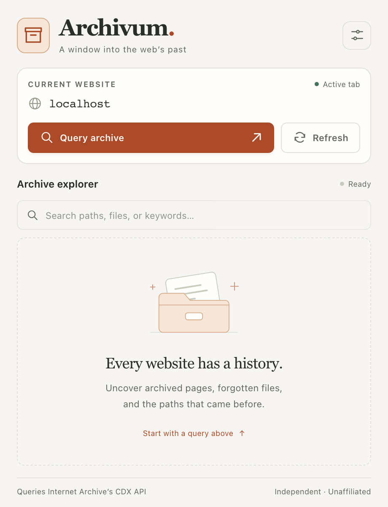
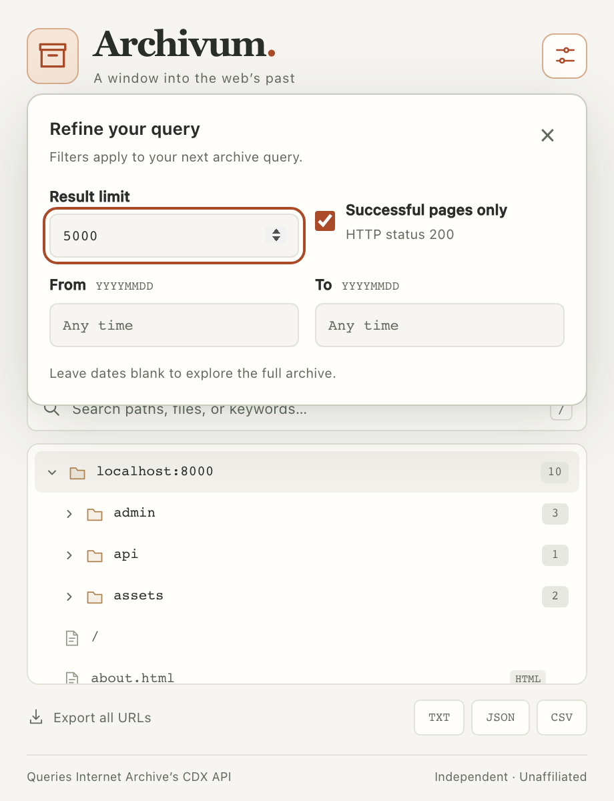

# Using Archivum

[← Back to the README](../README.md)

Archivum independently queries Internet Archive’s public CDX API. There is no partnership, affiliation, sponsorship, or endorsement. The screenshots below use the built-in **Local demo**, with synthetic URLs and dates.

## 1. Choose a website

Install the extension using the [README instructions](../README.md#install). Open an HTTP or HTTPS website and then open Archivum from the browser toolbar or extensions menu.

Check **Current website** before you query. Archivum uses the tab’s hostname, not the path of the page you are viewing. Internal browser pages such as `chrome://extensions`, local `file://` pages, and empty tabs cannot be queried.



## 2. Set optional filters

Select the sliders button in the top-right corner to open **Query options**.

| Control | How to use it |
| --- | --- |
| Result limit | Choose an integer between 100 and 50,000. The default is 5,000; smaller limits reduce the amount requested. |
| Successful pages only | Selected by default. Adds a filter for archived HTTP status `200`. Clear it to include other statuses returned by the API. |
| From | Optional start date, written as eight digits: `YYYYMMDD`, such as `20200101`. |
| To | Optional end date in the same format, such as `20241231`. It must be on or after the start date. |

Leave dates blank to avoid a date restriction. Invalid dates and out-of-range limits are flagged before a request is sent. Close the panel with **×**, `Esc`, or a click outside it, then select **Query archive**. Changing a filter alone does not query the API.

Options apply to the next query in the current popup. Reopening the popup restores the default options.



## 3. Browse the results

Select **Query archive**. A matching, unexpired cache entry is reused; otherwise the popup requests results from Internet Archive. **Refresh** always bypasses the cache.

- Expand folder rows to browse their contents. The badge shows how many returned URLs are beneath that folder.
- Directory landing pages remain available alongside their child pages. Query-string variants remain separate when the API returns them separately.
- File badges identify extensions. HTTP status badges appear for non-200 responses.
- Hover over a file to see its complete URL, capture date, and link behavior.


**Selecting a file opens its original URL in a new tab.** It does not open a historical snapshot. That navigation may contact the original website; the extension’s archive query itself does not crawl it.

**URLs found**, **Earliest capture**, and **Latest capture** summarize the returned records. A limited query with collapsed URLs is not a complete capture timeline. The status code describes the archived record, not the current website’s response.

The indicator next to **Archive explorer** distinguishes **Live results**, **From cache**, and **Local demo**. Here, “live” means freshly retrieved from the archive API, not a check of the current website.

## 4. Search locally

Type any URL text into the search field: `admin`, `.pdf`, `/assets/`, a hostname, or `?page=`. Matching text is highlighted. Search is case-insensitive and runs locally against the loaded records; it makes no additional Internet Archive requests.


| Shortcut | Action |
| --- | --- |
| `/` | Focus search when results are available and you are not typing in another input. |
| `Esc` | Close query options, or clear a nonempty search when search has focus. |
| `Tab` / `Shift+Tab` | Move between interactive controls. |
| `Enter` / `Space` on a folder | Expand or collapse that folder. |
| **×** in the search field | Clear the search and return to the folder tree. |

## 5. Export your findings

Select an export button below the results. All formats export **the full loaded result set**, even if a text search is active.

| Format | Filename | Contents |
| --- | --- | --- |
| TXT | `archivum_urls.txt` | One original URL per line |
| JSON | `archivum_records.json` | Records with `url`, `timestamp`, `status`, and `mimetype` |
| CSV | `archivum_records.csv` | The same four fields, with a header row and quoted values |

Example JSON record from the local demo:

```json
{
  "url": "http://localhost:8000/admin/login.html",
  "timestamp": "20240101120000",
  "status": "200",
  "mimetype": "text/html"
}
```

Timestamps are preserved in the API’s compact format. Exports are saved through your browser’s normal download behavior. Review them for sensitive URL text before sharing or publishing them.

## Try the local demo

To explore the interface without an Internet Archive request, open any page on `localhost` or `127.0.0.1`, then use the extension’s **Query archive** button. It creates ten sample URLs under that page’s origin and labels them **Local demo**. Demo records are fixed examples; date and status filters do not change them.

If you need a local page and have Python 3 installed, run this from the repository folder:

```sh
python3 -m http.server 8000 --bind 127.0.0.1
```

Open `http://localhost:8000/`, then open the extension. Stop the server with `Ctrl+C` when finished. This binds the development server to your own computer.

## Troubleshooting

| What you see | What to try |
| --- | --- |
| **Start with a website** | Open an HTTP or HTTPS page, then reopen the popup. |
| **No pages found this time** | Check the hostname, widen the date range, or clear **Successful pages only**. The archive may not contain matching records. |
| An HTTP error or timeout | Wait before retrying. Consider a smaller limit or narrower date range. Avoid repeated refreshes during service errors or rate limiting. |
| Only a subset of expected URLs | The result limit and URL collapsing constrain the response; Archivum does not automatically fetch additional pages of results. |
| A result does not open or returns an error | Links point to original URLs. A historical record does not guarantee that the current site still serves that path. |
| Old layout after editing files | Reload Archivum in the browser’s extension manager and reopen the popup. |
| A query stops when you close the popup | Queries run inside the popup, not a background worker. Keep it open until results appear. |

Read the [request and privacy details](../README.md#how-requests-work) and [responsible-use guidance](../README.md#responsible-use) before using real targets.
